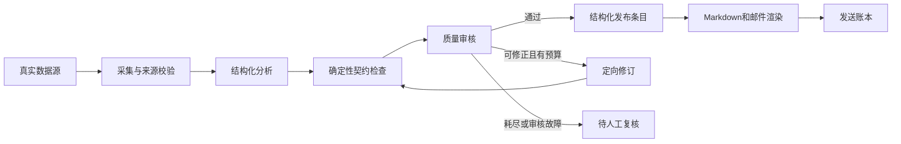

# SDD in Action：从个人实践到团队交付的落地方案

分析日期：2026-10-12。仓库基线：`master`，`7ccc24b38f7cae09897ace41ebae14780250ac86`。

这套方案将仓库中的书籍配套规范、四周行动营、案例代码和进阶问答，整理成可用于真实项目的开发机制。默认面向有存量系统的 5–15 人研发团队；个人可采用轻量版。周期、指标和分工均为实施建议，不代表作者原文或已验证的业务承诺。

**建议采用的主线：一个真实变更、一份明确行为规范、一组可执行验收、一次可追溯交付。先跑通这个闭环，再按实际痛点加入框架、多角色评审和 Agent 编排。**

配套文件：

- [仓库内容与落地缺口审计](./repository-audit.md)：已有内容、证据位置、规范与代码偏差、修正优先级。
- [可复用工作模板](./templates.md)：功能规范、设计、任务、ADR、验收矩阵、PR、发布和 AI 协作提示词。

## 1. 先把仓库里的内容串起来

### 1.1 三组材料，承担三种作用

| 内容 | 仓库已有材料 | 落地时的作用 |
|---|---|---|
| 书籍方法主线 | 根 README 的十章结构；`book-code/specs/` 的 proposal、design、tasks、contracts、ADR；Ch1/Ch3 练习 | 建立从需求到验收的规范链 |
| 四周行动营 | Week 1 基础规范；Week 2 变更生命周期和重试；Week 3 多角色与运行期工作流；Week 4 邮件交付与部署 | 演练逐步增加工程能力 |
| 进阶讨论 | 22 篇 `advance/` 文档 | 处理粒度、老项目、紧急修复、成本、记忆、工具冲突和推广边界 |

根 README 提供全书目录，但仓库没有十章完整正文。以下是对公开材料的系统整理，不是对未提供书稿的复述。

### 1.2 十章对应的落地能力

| 章节主题 | 在项目里转成什么 | 可见产物 |
|---|---|---|
| Ch1 Vibe Coding 问题诊断 | 排查需求蒸发、上下文漂移、不可审查、不可复现和不可维护 | 一页现状诊断与试点选择 |
| Ch2 SDD 核心思想 | 先定义行为，再设计实现，持续用证据校验 | 统一交付流程 |
| Ch3 工具链全景 | 按问题选工具和版本 | 工具职责表与版本记录 |
| Ch4 需求规范 | 明确价值、范围、非目标、异常与验收 | proposal + 功能 spec |
| Ch5 架构和 ADR | 管理接口、数据、失败路径、方案取舍 | design + schema + ADR |
| Ch6 任务拆解 | 按依赖拆成可单独验证的任务 | tasks + 验收追踪矩阵 |
| Ch7 老项目引入 | 保留现状证据，只补本次改动涉及的规范 | baseline + 特征测试 + delta |
| Ch8 Agent 模式 | 选择运行拓扑，约束数据与失败传播 | 编排图 + 协作契约 |
| Ch9 团队与组织 | 从个人样例推广到小组规则，再扩散 | PR 模板、责任人、培训样例 |
| Ch10 边界与融合 | 与敏捷、DevOps、TDD 衔接，按风险调整流程重量 | 分级门禁与例外记录 |

### 1.3 两条案例主线必须分开

**案例 A：团队工作日报。** `book-code` 定义采集 GitHub/飞书工作记录，生成成员日报，推送 HTML 邮件和飞书消息。本期明确排除 AI 语义总结，使用 Python、SQLite 和定时任务。适合练需求、契约、ADR、失败降级。

**案例 B：AI 技术情报知识库。** `week1–week4` 定义采集技术项目，经 LLM 分析和质量审核，整理入库并推送技术热点邮件。适合练 OpenSpec、重试、Agent 工作流、评估和成本治理。

两者共享开发方法，但数据、用户、渠道和验收标准不同。例如 A 的 HTML 工作日报，不能直接套用 B 的纯文本 Top 5 技术摘要规范。

## 2. SDD 的运行规则

### 2.1 三层事实，防止规范变成另一个幻觉来源

1. **期望行为**：业务负责人确认的 spec，描述系统应该怎么做。
2. **当前行为**：现有代码、日志和测试证明的 baseline，描述现在怎么做。
3. **交付证据**：测试结果、评审记录和运行数据，说明这次改变了什么。

发现差异时，先判断是实现缺陷、需求变更还是原规范错误；不能为了让检查通过就随意改测试或回填规范。规范是一等工件，但必须可修订。代码由规范指导，也需要独立的安全与正确性审查。

### 2.2 每个行为变更的最小闭环


| 步骤 | 必须解决的问题 | 出口条件 |
|---|---|---|
| 需求与澄清 | 谁受益、痛点证据、现状、这次边界 | 验收能判断对错；关键业务问题有人负责 |
| 设计 | 输入输出、接口、不变量、失败和恢复 | 契约可校验；消费者已考虑；决策有理由 |
| 拆任务 | 依赖、责任范围、测试、交付顺序 | 每条需求都有任务和验证方法 |
| 实现 | 最小改动；修复先复现；核心行为先测试 | 实现符合契约；相关回归通过 |
| 验证 | spec、代码、测试是否一致 | 没有未解决的阻断差异；有具体证据 |
| 发布与沉淀 | 如何上线、观察、回退、交接 | 发布结果记录；主规范与最终行为一致；变更可追溯 |

框架的 `/verify` 是辅助审查，不能替代运行测试和真实业务验收；`archive` 是归档动作，也不能作为发布成功的证据。

### 2.3 按风险决定文档重量

| 等级 | 适用情况 | 要求 |
|---|---|---|
| L0 | 拼写、文档排版、无行为变化的小改动 | 写清改动；做相应检查；不强制新增功能规范 |
| L1 | 单模块小功能、普通 bug | 四段式 spec + 验收/回归测试 + PR 证据；设计可放同一文件 |
| L2 | 跨模块、持久化、接口、外部集成 | proposal/spec/design/tasks + 契约 + 验收矩阵；关键取舍用 ADR |
| L3 | 数据迁移、权限、关键业务、多 Agent 发布链 | L2 + 威胁/失败分析 + 兼容与回滚方案 + 专项评审 + 演练 |

等级由影响范围、可逆性和故障后果决定，不由代码行数决定。一个权限判断即使只改一行，也可能是 L3。生产代码的关键行为采用 TDD；低影响文档修改不用为凑流程写测试。

## 3. 把规范落到仓库，而不是留在对话里

### 3.1 推荐目录

以下为生产项目建议，尚未创建在本仓库：

```text
project/
├── AGENTS.md                    # AI 工作规则、命令入口、规范指针
├── docs/
│   ├── vision.md                # 业务目标与长期边界
│   ├── architecture.md          # 当前系统结构，链接 ADR
│   ├── adr/                     # 决策与替代关系
│   └── runbooks/                # 发布、重跑、回滚、故障处理
├── specs/
│   ├── contracts/               # JSON Schema/OpenAPI 等可执行契约
│   └── governance/              # 安全、成本、质量、可观测性
├── openspec/
│   ├── specs/<capability>/spec.md # 当前已接受的行为规范
│   └── changes/<change-id>/     # proposal/design/tasks/specs + 验收记录
├── src/
└── tests/
    ├── unit/
    ├── contract/
    ├── integration/
    └── evals/
```

轻量版可以只用 `specs/features/<feature>.md`、`docs/adr/` 和测试，不必初始化 OpenSpec。采用 OpenSpec 后，能力行为以 `openspec/specs/` 为主，避免另一份 `specs/features/` 同时维护相同规则。

### 3.2 各种工件各管什么

| 工件 | 管什么 | 不应该塞进去的内容 |
|---|---|---|
| vision | 用户、价值、整体范围 | 每次实现的细节 |
| proposal | 这次为什么改、改哪里、影响谁 | 复制整份长期行为规范 |
| spec | 可验证的行为、边界、场景、不变量 | 临时聊天与无依据的指标 |
| design | 模块、数据流、技术约束、失败恢复 | 未确认的业务需求 |
| contract/schema | 字段、类型、状态、版本、兼容性 | 只写自然语言而不能校验 |
| ADR | 重大选择、其他选项、理由、后果 | 每个局部变量的选择 |
| tasks | 责任范围、依赖、输出、验证 | 只有“完成模块”这种不可验收的动作 |
| acceptance | 需求→测试→结果→人工确认 | 只把任务复选框打勾 |
| AGENTS.md | 行为约束、工具命令、资料入口 | 历史课程说明或复制过时的功能状态 |

### 3.3 唯一规则与追溯

每条关键需求有稳定 ID，例如 `COL-003`、`QLT-002`。任务、测试、PR 和发布记录引用该 ID。接口字段以可执行契约为准，Markdown 解释语义并引用它，不复制出另一份不一致的定义。

最低追溯链：`需求 ID → 任务 ID → 代码/PR → 测试用例 → 验证结果 → 发布版本`。这是组织扩张后最值得保留的资产。

数值必须标注来源：业务要求、现状测量、容量估计、或待验证假设。仓库里的 $0.50/天、$5/天、80% 覆盖率、0.6 置信度都是不同上下文的示例，不能一并作为生产指标。

## 4. 工具如何配合

### 4.1 默认选型

| 需求 | 默认做法 | 升级信号 |
|---|---|---|
| 个人、小功能、刚开始学习 | Markdown 模板 + AGENTS.md + Git + 测试 | 找不到历史决定；多人变更冲突 |
| 长期维护、多人迭代 | OpenSpec 管主规范与变更生命周期 | 业务、架构、质量视角反复遗漏 |
| 决策复杂、需多视角 | 对关键决策使用 BMAD 角色评审 | 实现纪律和回归质量仍不稳定 |
| 实现、调试、验证需要标准流程 | 选用 Superpowers 对应技能 | 流程开销超过收益时简化 |
| 需要 Constitution 和正式分阶段工件 | 评估 Spec Kit 作为另一条主流程 | 与既有工具做同题试点再决定 |

推荐团队试点默认采用 **OpenSpec + 项目规则 + 行为测试**；BMAD 和 Superpowers 按阶段使用。不要求四套工具都安装，也不同时用 OpenSpec 与 Spec Kit 管同一个变更的事实来源。

### 4.2 职责与交接

```text
追问需求（grill-me 或人工）
  → 多视角审查（复杂决策才使用 BMAD）
  → 写入唯一变更工件（OpenSpec 或手写）
  → 按任务实现、测试、调试（可使用 Superpowers）
  → 独立评审、发布、同步和归档
```

交接时只传确认的规范、未决问题、契约和验收，不传一大段未经整理的聊天。阶段内只有一个流程负责人；其他工具提供评审意见，不再生成一套平行需求和任务。

特别区分：**开发期 AI 角色**帮助研发团队思考和编码；**产品运行期 Agent**是系统中的节点、函数和模型调用。使用 BMAD 评审不意味着产品必须采用多 Agent。

### 4.3 工具时效核查

2026-10-12 对官方资料做了核查：

- OpenSpec 官方入门目前展示 `explore → propose → apply → archive` 的快速路径；expanded 命令通过 `openspec config profile` 配置，再运行 `openspec update`。因此仓库“propose 已被淘汰”和“只能手工改 workflows 数组”的说法不宜作为现行操作指南。[官方入门](https://github.com/Fission-AI/OpenSpec/blob/main/docs/getting-started.md)
- 归档位置是 `openspec/changes/archive/`，主规范在 `openspec/specs/`。仓库 Week 2 实物与此一致，部分 advance 文档的 `openspec/archive/` 写法需修正。[官方入门](https://github.com/Fission-AI/OpenSpec/blob/main/docs/getting-started.md)
- Spec Kit 命令呈现与 Agent 集成方式有关；正式采用时按所选 Agent 的官方集成核实。其跨工件分析用于发现规范、设计、任务间的缺口。[官方命令参考](https://github.github.com/spec-kit/reference/agentic-sdd.html)
- BMAD、Superpowers 的安装与工作流入口以各自官方说明和选定版本为准，仓库中的角色数量、星标数、市场名称不进入交付约束。[BMAD 官方安装](https://github.com/bmad-code-org/BMAD-METHOD/blob/main/docs/start/install-bmad.md)、[Superpowers 官方仓库](https://github.com/obra/superpowers)

团队工具登记至少记录工具版本/提交、Agent、启用命令、配置目录、升级负责人和最后验证日期。生产项目固定验证过的版本，升级在独立变更中验证。

## 5. 日常研发怎么执行

### 5.1 一次正常功能变更

以“给模型调用加入重试”为例：

1. 记录故障证据：哪类错误、哪一步丢失产物、现有降级是否有效。
2. 写明边界：只改变调用层；内容错误与网络错误分开；是否处理 Retry-After；是否包含 SDK 内建重试。
3. 统一语义：`max_attempts=4` 表示首次 + 3 次重试；最大延迟约束的是最终 sleep，而非抖动之前的中间值。
4. 设计接口：成功响应含 usage；失败保留错误类型、尝试次数和费用未知状态。
5. 写验收：超时后成功、5xx 耗尽、401 立即失败、非法结构降级、后续条目继续、全失败整批状态、预算边界。
6. 任务先验证再实现，mock sleep、时钟、网络和模型；不在单测里等待真实退避。
7. 人工审查策略与代码，再运行测试。无法获得 usage 的失败调用记为未知，后续与供应商账单核对。
8. 发布后观察错误率、调用次数、延迟、费用；最终更新主规范和归档。

每一步都应产出可复用证据，不能只剩“AI 说完成了”。本仓库 Week 2 提供了这个变更的完整工件链，但仍有文档与实现差异，见审计。

### 5.2 老项目引入

选择接下来必然要改的一个模块。先查入口、调用者、持久化与外部副作用；用测试或日志写当前行为 baseline，并明确标注“不符合期望的历史行为”。再写这次目标行为 delta，补特征测试，保持未涉及行为稳定。

顺序：`现状证据 → baseline → 目标 delta → 回归保护 → 小步实现 → 验证 → 主规范`。不要求先给全仓补齐规范；文档覆盖优先跟随改动频率、交接风险与业务重要性。

仓库 `/opsx:onboard` 的实际命令文件是引导完成第一次变更周期，不能承诺它会自动为整个老系统逆向生成可信 baseline。baseline 仍要通过源码、调用链、现有测试和负责人校对。

### 5.3 紧急修复

先恢复服务：回滚、禁用故障功能、降低负载等按现有应急流程执行。代码修复至少留下现象、影响范围、复现/日志、拟修复行为、验证和回滚点。恢复后补回归测试和规范记录，再做原因分析。

不把仓库“30 分钟”经验值变成组织硬规则；依据故障等级和已有应急机制决策。事后补规范要有责任人和期限，建议下一工作日内完成；无法完成的事项进入跟踪票。

## 6. 两个案例怎么真正做出来

### 6.1 案例 A：先做可靠的团队工作日报

推荐将它作为首次完整交付练习，因为一期可以不用运行期 LLM，便于隔离工程问题。

| 迭代 | 范围 | 验收 |
|---|---|---|
| A0 契约修正 | 采集窗口、平台范围、CollectResult、记录唯一 ID、身份映射 | 无数据与失败能区分；设计、契约、任务一致 |
| A1 单源闭环 | GitHub → 成员归属 → Markdown/HTML → dry-run | 分页、窗口、无记录、部分失败、转义测试通过 |
| A2 多源和存储 | 飞书任务/消息、SQLite、隔离采集失败 | 单源失败仍产正确日报；全部失败不产假日报；持久化可重跑 |
| A3 推送和调度 | SMTP、飞书、工作日日历、发送状态 | 各渠道状态独立；重启可恢复；重复触发受控；失败可告警 |
| A4 试运行 | 一支小组限定渠道试用 | 人工对照原始记录；验证权限、时区、性能和备份恢复 |

A0 必须裁决 proposal 的“过去 24 小时”与“当天 00:00 到执行时刻”差异；建议明确业务时区并使用 `[since, until)` 窗口。GitLab/Jira 若不在一期就改清范围，不能只在需求中提到而没有对应适配器和验收。

采集状态建议由 `CollectResult` 表达：成功、空数据、部分结果、失败以及错误码；不通过裸空列表传递所有状态。配置和密钥分离；消息只采集白名单范围；输出 HTML 转义外部文本。

性能沿用书籍的“5 人团队 <60 秒”作为待实测目标：拆出请求超时、重试和整体截止时间，使用真实代表性数据压测。mock 跑得快不能证明真实 API 达标。

### 6.2 案例 B：把技术情报知识库做成可发布的服务



| 迭代 | 范围 | 出口条件 |
|---|---|---|
| B0 统一行为 | GitHub Trending 或 Search 二选一；统一字段、日期和输出路径 | 主规范、输入输出 schema、所有消费者一致 |
| B1 可靠流水线 | 采集→分析→校验→整理；重试、错误分类、单次总预算 | 离线端到端及故障注入通过；有失败产物 |
| B2 质量闭环 | 按条目审核、修订上限、待审处理与审计 | 审核失败不自动发布；队列溢出不绕过质量门禁 |
| B3 成本与观测 | 统一调用网关、费用台账、预算预留、trace/run_id | 调用前限额；坏 JSON 也计调用费用；运行可追踪 |
| B4 真实 Digest | 从结构化条目选 Top 5，纯文本模板、真实取消订阅 | 不再发 mock；不足 5 条如实显示；取消后不再发送 |
| B5 部署恢复 | 可构建镜像、持久化状态、调度、重跑、告警 | 重启、失败补发、健康检查和恢复演练通过 |

**结构化 JSON 是发布输入，Markdown 和邮件是渲染产物。** 不建议让邮件服务从 Markdown 反解析业务字段。明确 Top 5 的排序字段：如采用 `innovation_level` 和 `stars`，则分析与持久化必须保留这些字段；不要用 `relevance_score` 暗中替代创新度。

MVP 先用明确的固定 pipeline。只有实测证明审核修订带来质量收益，才保留七节点流程。Planner、Collector、Organizer 等确定性节点不需要强行调用模型。Router 适合交互查询分流；Supervisor 适合真正有独立子任务的协调，当前演示不能当真实采集器。

## 7. Agent 系统必须增加的契约

普通 SDD 管行为；多 Agent 还要管交接和状态。建议在 design/contract 中增加：

| 契约 | 必须明确的内容 |
|---|---|
| 数据 | schema_version、item_id、来源 URL、输入摘要、字段类型与必填、质量状态 |
| 时序 | 日期分区、触发条件、超时、并发上限、写盘完成与读取顺序 |
| 失败传播 | 错误分类、可重试性、partial/failed/skipped/needs_review、下游允许条件 |
| 状态恢复 | run_id、checkpoint、输入指纹、重跑范围、原子写入、幂等键 |
| 预算 | 每节点/每运行/每天/每月；并发预留；循环和重试共享预算 |
| 观测 | run_id、节点、版本、attempt、耗时、条数、usage、error_code |
| 变更兼容 | 增量字段、破坏性变更、消费者测试、切换和回退 |
| 记忆 | 谁能读取、保留条数/时间/Token、清洗条件、升级失效条件 |

`TypedDict` 提供开发期类型提示，不能替代运行时校验。模型生成的 JSON 合法也不代表字段、数值和业务关系正确。

质量判断至少区分：结构合法性、来源可验证性、内容准确性、业务相关性。模型自报 confidence、业务 relevance 和 Reviewer 分数不是同一个指标；阈值需要用人工标注样本校准，不能直接把 0.6 当成准确率保证。

Reviewer 和 Reviser 的职责分开能减少自我确认，但共享模型的错误仍可能相关。保留人工对照样本，加入真实错误和对抗样本，不以“另一个 Agent 同意”作为唯一质量证据。

## 8. 质量门禁和运行治理

### 8.1 从确定性检查开始

| 层级 | 检查 | 通过标准 |
|---|---|---|
| 本地 | 格式、快速静态检查、staged schema | 秒级反馈；可诊断；不发网络请求 |
| PR | 需求/任务/测试映射、lint、类型、单测、契约、mock 集成 | 所有阻断检查通过；关键行为有验证；人工 review |
| 受控评估 | 固定样本、固定模型/Prompt 版本、人工标注比较、成本和延迟 | 与批准基线比较；重要退化有解释和决策 |
| 发布前 | dry-run、配置/权限、数据库兼容、回滚和恢复演练 | 具体版本可运行；产物和迁移可回退或补偿 |
| 运行期 | 完成时间、数据完整度、待审积压、发送状态、成本 | 有明确 owner、异常分级和处置动作 |

PR 的默认测试不访问真实模型、GitHub 或 SMTP；真实评估单独显式启用，设置调用和费用上限。测试跳过必须在结果里显示，不能把“跳过付费测试”当成该能力通过。

本地 hook 可绕过，因此 CI 才是统一门禁。schema 与数据同时修改也要验证新契约的合法性和兼容性；不能因为一起修改就全面放行。

测试应调用真实业务函数和路由函数，不要在测试里重新写一份条件逻辑来证明它成立。本仓库的“第三次强制通过”测试与实际 HumanFlag 路由不一致，是这条规则的具体反例。

### 8.2 预算机制

预算使用统一币种与时间分区，单价来自团队核准配置并带生效日期。已知费用与未知费用分别记账；网络断开或解析失败并不能证明供应商未计费。

推荐先在调用前估算并预留预算，调用后按 usage 结算；并发和重试使用同一个账本。到预警区间可切换已通过评估的低成本模型或减少处理量；达到硬上限禁止新增非应急调用。不能一边叫“100% 硬上限”，一边设计成“120% 才停”。

月预算与日预算联动：每天额度取日配置额度与月剩余额度的较小值。固定美元/人民币金额由试点测量后确定，不沿用示例模型单价。

### 8.3 发布、幂等和恢复

发送建议有独立账本：`date + recipient + content_version + channel` 唯一键，记录 pending/sending/sent/failed/uncertain。重跑只处理失败或待发送项，不能只用“当日一个 .done 文件”代表所有订阅者成功。

SMTP 在“服务端已接受、客户端未收到确认”时可能产生不确定状态；单靠本地标记不能保证严格 exactly-once。需记录 Message-ID、不确定状态和人工处置；如选择自动重试，要接受并明确重复发送风险。

`.done` 只能在数据校验与原子写入后创建，同时记录输入指纹和版本，避免上游改变后仍误跳过。文件系统可用于单机 MVP，队列和数据库由恢复、并发与查询需求驱动，不为教学中的新工具而引入。

调度按完成依赖触发更可靠；时间表仅作为预期。技术情报的 UTC 0:00/0:30 对应北京时间 08:00/08:30。工作日报的“18:00”必须绑定团队业务时区与工作日日历，两条产品不要共用一个默认日期规则。

健康检查不仅看 cron 进程，还看最近成功时间、输入更新时间、未完成运行和发送积压。SQLite/文件存储要有备份与恢复演练；故障告警发送给该模块的值班 owner。

## 9. 团队如何分工

| 决策/产物 | 最终负责人 | 参与者 |
|---|---|---|
| 业务目标、范围和验收 | 产品/业务 owner | 开发、QA、AI 评审 |
| 接口、数据、架构和 ADR | 技术 owner | 开发、运维、消费者 owner |
| 实现和测试证据 | 变更作者 | AI 编码助手、QA |
| 独立评审与合入 | Reviewer/仓库维护者 | 变更作者、相关领域 owner |
| 发布、观测和回滚 | 发布/运维 owner | 开发、QA |
| 规范更新和归档 | 变更作者，维护者检查 | 产品与技术 owner |

小团队可以兼任，但 AI 角色不能替代人类业务责任。跨模块契约有明确维护人。定义“就绪”时关键需求必须确定；定义“完成”时验证与主规范同步必须有证据。

推广先从一位推动者和一个真实样例开始，再邀请两三名同事试用；收益稳定后写进小组 PR 规则。组织阶段提供短培训、标准模板和例外路径，但不要求所有项目安装同一种框架。

组织统一：风险等级、工件最低字段、验收与证据、归档、重大契约和密钥规则。团队自主：工具、文档布局、测试框架和具体执行方式。

## 10. 八周实施计划

这是建议节奏，遇到未满足出口条件时先补齐，不能只按日历升级工具。

| 周 | 工作 | 交付物 | 出口条件 |
|---|---|---|---|
| W0 基线 | 选一个试点模块；看近期 PR/事故；明确 owner | 问题清单、度量基线、试点范围 | 有可验证痛点；能比较前后表现 |
| W1 最小闭环 | 用四段模板做一个真实变更；建立规则入口 | spec、任务、测试、PR 样例 | 新人能照样例完成一次变更 |
| W2 生命周期 | 引入一个规范主流程；管理 delta 与归档 | 主规范、change 工件、验收矩阵 | 能从 PR 找到需求、结果与最终规范 |
| W3 契约与回归 | 统一 schema、错误分类、日期和重跑 | 契约测试、特征测试、故障场景 | 正常/空/部分失败/全失败区别明确 |
| W4 质量门禁 | 接入 PR 检查；独立 review；修正规范漂移 | CI、PR 模板、关键行为测试 | 失败检查会阻止合入；例外可追溯 |
| W5 生产能力 | 成本、日志、持久化、发布与恢复 | budget spec、runbook、运行证据 | 预算与故障演练通过；有回退路线 |
| W6 小组试用 | 两三位开发使用；按需多角色审查 | 多人变更记录、问题反馈 | 同一套规范能支持多人交接 |
| W7 复盘扩散 | 比较基线；删掉无价值步骤；选择下一团队 | 效果报告、模板 v1、扩展计划 | 收益有证据，开销可接受；负责人接手 |

个人方案可以压缩为两周：第一周用模板完成两个真实小变更；第二周补一个存量模块 baseline、回归和归档。组织推广一般需要更久，八周只承诺试点机制，不承诺全组织成熟。

### 10.1 度量怎么做

| 指标 | 定义与采集 | 用途 |
|---|---|---|
| 交付周期 | 需求就绪到合入/发布；分别统计中位数和长尾 | 看是否真的变快，区分需求等待 |
| 评审往返 | 每 PR 实质性修改轮数与阻断原因 | 看规范是否减少重复追问 |
| 返工 | 因理解错误或边界遗漏产生的修改，统一分类 | 直接衡量 SDD 价值 |
| 生产缺陷 | 发布后归因于本次变更的缺陷，按风险分层 | 避免只看测试数量 |
| 规范漂移 | 抽样变更中的行为冲突与未同步条款 | 检查事实来源是否可信 |
| AI 费用 | 编码辅助费与产品运行费分别记录 | 避免把两类成本混为一谈 |
| 流程开销 | 规范/评审时间与总交付时间 | 防止模板和角色过重 |

先测基线，再设改善目标。不要预先承诺“提升 50%”或照搬覆盖率阈值。试点至少积累若干同类型变更再比较，记录复杂度和风险差异；样本小就只报告观察，不做因果结论。

## 11. 第一批可以直接排入 Backlog 的工作

| 优先级 | 变更包 | 主要范围 | 完成标准 |
|---|---|---|---|
| P0 | 统一书籍案例契约 | A 的设计/数据模型/Task 3–6/ADR-003 | 所有签名与失败语义一致；时间窗明确 |
| P0 | 统一行动营发布输入 | B 的各阶段 schema、输出、Digest 输入 | JSON→Digest 离线闭环，无 mock 内容 |
| P0 | 修正质量放行 | Reviewer 故障、低置信、溢出处理 | 故障和未审核条目不自动发布 |
| P0 | 补齐可构建部署 | requirements、配置样例、日志、健康检查、可写状态 | 新环境构建与启动通过，重启恢复通过 |
| P1 | 测试真实行为 | 路由、字段、失败、发送账本 | 测试调用真实函数；所有阻断场景有证据 |
| P1 | 成本和恢复 | 统一调用边界、预算、日期、checkpoint | 不越硬上限启动调用；重跑行为明确 |
| P1 | 修正上下文 | AGENTS、OpenSpec 工件、命令和路径 | AI 入口不再把完成态当无 retry 基线 |
| P2 | 质量与规模优化 | 固定评估集、trace、查询路由、容量 | 先证明需求，再扩模式和基础设施 |

建议落地顺序：**先用案例 A 跑通一个无运行期 LLM 的完整 SDD 交付，再用案例 B 验证 Agent 专属的质量、成本与发布治理。** 如果团队正在做 AI 产品，可直接从 B0 开始，但仍保留同样的规范→测试→发布证据链。

## 12. 本次分析的证据边界

已阅读公开方法文档、业务规范、关键工作流/重试/邮件源码和测试，并检查目录与 zip。工具生成的 BMAD/OpenSpec 文件按入口、用途和版本管理材料归类，没有把所有上游 vendored 提示词逐行当作书籍原创内容。

代码图已索引并检查覆盖；部分路径出现 metadata_changed，已回读关键源码。Dockerfile 的部分解析缺口已直接读取。全量运行测试与容器构建没有执行：当前 Python 环境缺少 pytest、openai、httpx、langgraph、yaml。本次没有调用真实模型、抓取业务数据或发送邮件。静态核查和离线行为检查的实际结果见审计文件。

工作区已有未跟踪的 `sdd-rollout-briefing.html` 和 PNG，是另一份推广材料；它与 advance 中的推广建议有不同取向。本方案采用按阶段、按已有收益引入会议、培训和门禁的方式，没有改动这些原有文件。
